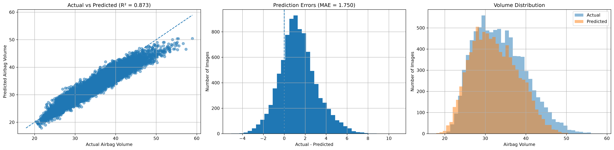
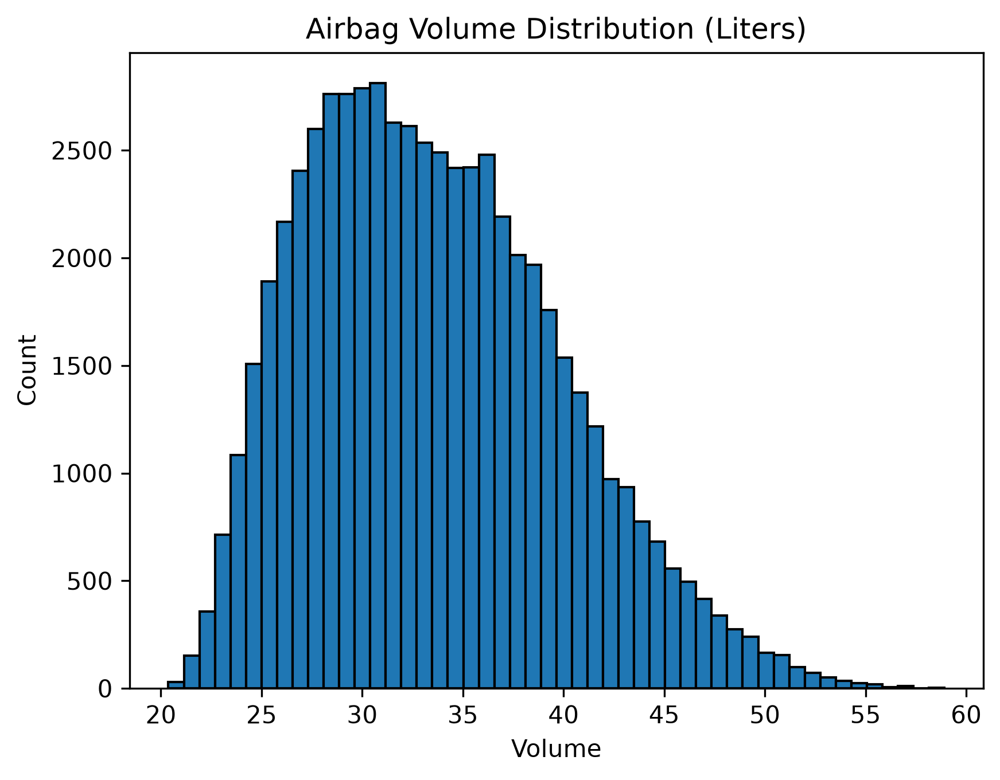

# Airbag CAD-to-CAE Volume Prediction using CNN

## Project Overview

This project develops a **Convolutional Neural Network (CNN)** using PyTorch to predict airbag volume directly from grayscale CAD images.

The model learns visual patterns in airbag designs and maps them to a continuous engineering output: predicted airbag volume. The project explores how deep learning can connect computer-aided design (CAD) with data-driven engineering prediction.

The workflow includes image preprocessing, data augmentation, custom dataset development, CNN architecture design, GPU-accelerated training, and quantitative model evaluation.

## Objective

Develop and evaluate a CNN regression model that estimates airbag volume from CAD images, demonstrating the potential of computer vision for faster preliminary engineering design evaluation.

## Dataset

- **Data source:** [Airbag CAD-to-CAE Volume Dataset — Kaggle](https://www.kaggle.com/datasets/mohammadrad/airbag-cad-to-cae-volume)
- **Input:** Grayscale airbag CAD images.
- **Target:** Corresponding airbag volume values.
- **Dataset scale:** Approximately 60,000 image samples.
- **Task:** Image-based regression.

Each image is associated with a numerical volume target used to train the model.

## Methodology

### 1. Image Preprocessing

- Load CAD images in grayscale.
- Resize images to `224 × 224` pixels.
- Normalize image pixel values.
- Apply training-time augmentation using random shifts, scaling, and rotations.
- Convert images into PyTorch tensors.

### 2. Custom PyTorch Dataset

A custom dataset class connects each image to its corresponding volume target and prepares samples for efficient batch-based training.

### 3. CNN Architecture

The network uses three convolutional feature-extraction blocks with progressively increasing channel counts:

`1 → 32 → 64 → 128`

Each block contains convolutional layers, batch normalization, ReLU activations, and max pooling.

The regression head uses adaptive average pooling, followed by fully connected layers to produce a **single continuous volume prediction**.

### 4. Training and Evaluation

- Framework: PyTorch
- Optimizer: Adam
- Loss function: Mean Squared Error (MSE)
- Hardware acceleration: CUDA-enabled GPU
- Training duration: 2 epochs
- Evaluation: Held-out test set of 9,000 samples

## Model Performance

The following metrics were obtained from the latest notebook run.

| Evaluation Metric | Result |
|---|---:|
| Test Samples | 9,000 |
| Mean Absolute Error (MAE) | 1.7501 |
| Root Mean Squared Error (RMSE) | 2.2375 |
| R² Score | 0.8728 |
| Test Evaluation Time | 42.43 seconds |

### What the Results Mean

- **MAE = 1.7501:** The average absolute difference between predicted and actual volume is approximately 1.75 volume units.
- **RMSE = 2.2375:** Larger prediction errors receive greater weight, providing another measure of regression performance.
- **R² = 0.8728:** The model explains approximately 87.3% of the variation in the test-set volume targets.

*The interpretation of absolute errors depends on the volume units used in the original dataset.*

## Visual Results

### Actual vs. Predicted Volume, Error Distribution, and Volume Distribution

<p align="center">
  
</p>

The three-panel visualization examines:

1. **Actual vs. Predicted:** How closely the model's estimates follow the ideal prediction line.
2. **Prediction Errors:** The distribution of differences between actual and predicted values.
3. **Volume Distribution:** The distributions of actual targets and model predictions.

### Airbag Volume Target Distribution

<p align="center">
  
</p>

This plot helps inspect the range and distribution of volume values represented in the dataset.

**Note:** The visualization files retain their existing filenames. If the figures contain metrics or predictions from a previous run, regenerate and save them using the latest test predictions to keep the plots consistent with the reported results.

## Engineering Relevance

Predicting airbag volume from CAD images is an example of using computer vision to estimate engineering quantities from design representations.

A model of this kind could support rapid preliminary screening of designs and help investigate data-driven CAD-to-CAE workflows. Its practical value depends on the accuracy, consistency, and engineering validity of the predictions across unseen designs.

**This project predicts volume only. It does not currently predict airbag stress or replace finite element analysis (FEA), physical testing, or engineering validation.**

## Key Achievements

- Developed an end-to-end image-regression pipeline in PyTorch.
- Built a custom dataset for pairing CAD images with numerical targets.
- Implemented a multi-block CNN for visual feature extraction.
- Used GPU acceleration for model training and inference.
- Evaluated performance using MAE, RMSE, and R².
- Achieved an R² score of **0.8728** on 9,000 test samples.

## Future Improvements

- Experiment with additional training epochs and learning-rate tuning.
- Investigate generalization across different airbag geometries.
- Compare alternative CNN architectures and image resolutions.
- Analyze prediction errors across different volume ranges.
- Explore extensions to other engineering outputs when suitable labeled simulation data are available.

## Project Structure

```text
airbag_cad_to_cae_volume_prediction/
├── images/
│   ├── airbag_volume_distribution.png
│   └── airbag_prediction_visualization.png
├── airbag_cad_to_cae_volume_prediction_cnn.ipynb
└── README.md
```

## Technologies Used

- Python
- PyTorch
- OpenCV
- Albumentations
- NumPy
- Pandas
- Matplotlib
- Scikit-learn
- CUDA

## Setup

1. Clone the repo: `git clone https://github.com/ZainShah740/engineering-ai-applications.git`
2. Move into the project folder: `cd engineering-ai-applications/airbag_cad_to_cae_volume_prediction`
3. Install dependencies: `pip install -r requirements.txt`
4. Download the dataset from [Kaggle](https://www.kaggle.com/datasets/mohammadrad/airbag-cad-to-cae-volume) and place it in the `air_bag_data` folder.
5. Open `airbag_cad_to_cae_volume_prediction_cnn.ipynb` in Jupyter to explore the full workflow.


## 🤝 Connect for Collaboration

Open to discussions on AI, predictive maintenance, or industrial projects—let’s create impactful solutions!

- <a href="https://www.linkedin.com/in/zain-shah-871aa532a">
     LinkedIn
  </a>

- <a href="https://x.com/zainshah_x">
     Twitter (X)
  </a>

- <a href="mailto:btenmeten12345@gmail.com">
     Gmail
  </a>

⭐ Star if useful, and check my profile for more projects!